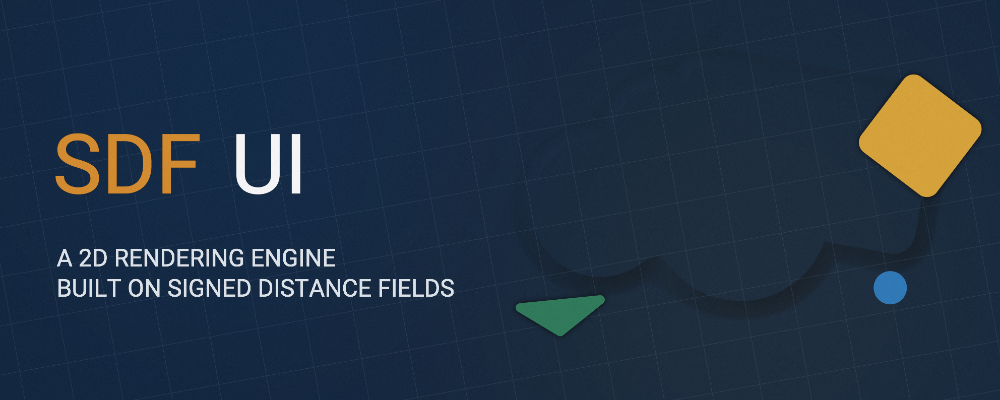

# SDF UI

What started [here](https://github.com/sebastianjkern/metaballs), has become a not yet fully featured but relatively complex 2d graphics rendering engine with gpu support.

SDF UI is the result of the experiment if you can extend the idea of MSDF text rendering and SDF based circle rendering to all standard 2D rendering stuff. Why don't draw rectangles, bezier curves, lines etc. with SDFs aswell. While in theory this is quiet slow, it offers great features like morphing between figures pretty much out of the box. And the determining factor of rendering cost is the size of the canvas and not the complexity of the object. For example the grid in the picture down below has pretty much the same cost as the rounded rectangle. And pretty much everything can be drawn with antialiasing without additional cost. And depending on what you're drawing, the rendered textures can be used again. 

Many SDFs used by this project were originally created by [Inigo Quilez](https://iquilezles.org/articles/distfunctions2d/).


### Why are basic Features not available?

All roads lead to Rome. Many basic sdf shapes can be expressed trough boolean operations of other basic shapes. For example convex polygons can be expressed as the intersection of halfplanes. Non-convex polygons are not as simple, but can be expressed trough this technique aswell. The trick is to render the union of convex polygons that make up the non-convex polygon.

The library also provides arc, half-plane, capsule, and polygon primitives directly.

### But why should i use the sdf-ui library?

While some functionality is not yet available or quiet expensive, many features are cost effective in comparison. While traditional render pipelines (atleast if they don't copy memory) have problems with repetition (Drawing 1000 circles is more expensive than 1 circle), sdf-ui can flex its muscles, because drawing equally spaced objects multiple times comes at a fixed cost. Drawing 1000 circles in a grid is not more expansive than drawing 100 circles in a grid.

This makes the renderer especially interesting for procedural 2D scenes, repeated motifs, boolean-heavy shape construction, and soft effects like antialiasing, outlines, masks, and morphing. Instead of paying mainly for scene complexity, many operations behave more like full-canvas field evaluation, which opens up a different set of strengths than a traditional draw-call-based backend.

### Installation:

The project requires Python 3.10 or newer and can be installed with pip:

```bash
pip install git+https://github.com/sebastianjkern/sdf_ui
```

For interactive work, prefer `Canvas.render(...)`, the built-in `.save(...)` method on render nodes, or a cached `Canvas.session(...)`.

Text and glyph rendering use the bundled Roboto font by default. Pass an explicit
TrueType font path to use a different font.


For development from a checkout, install [uv](https://docs.astral.sh/uv/getting-started/installation/) and run:

```bash
uv sync
uv run pytest
uv run python -m examples render_api
uv run python -m examples.learned_dashboard --steps 80
uv build
```

The lockfile keeps development and CI dependencies consistent. See
[the example index](examples/README.md) for more examples.

### Usage:

The public API is built around render nodes. `sdf` creates signed-distance-field textures,
`color` creates color textures, and `Canvas` materializes the same nodes on the GPU:

```python
from sdf_ui import Canvas, color, sdf

scene = (
    color.clear("#ffffff")
    .over(
        sdf.circle(("40%x", "50%y"), "18%min")
        .smooth_union(sdf.rect(("58%x", "50%y"), ("22%x", "18%y"), ("3%min", "3%min", "3%min", "3%min")), k="2%min")
        .fill("#62bb47", (0.0, 0.0, 0.0, 0.0))
    )
    .post.blur(1)
    .to_rgb()
)

cache = {}
with Canvas((640, 360)) as canvas:
    scene.save("out.png", ctx=canvas, cache=cache)
```

### Architecture Note

Internally, `sdf_ui` is organized around immutable render nodes instead of immediate drawing calls.
Factories such as `sdf.circle(...)` and `color.clear(...)` do not render right away. They build a
small expression graph of `TextureNode` objects that can be composed, cached, and rendered later
against a `Canvas`.

At render time, the node graph is resolved by the renderer and dispatched through the plugin
registry. Each primitive, shading step, layer operation, or postprocessing effect is registered as
plugin metadata plus shader code, which keeps the runtime extensible without forcing the public API
to be hardcoded in one giant module.

To keep editor support and static analysis usable for library users, the public typed API is
generated from plugin metadata and the resulting stubs are tracked in the repository. New plugins can extend the runtime
surface while shipped `.pyi` stubs still provide autocomplete and type checking for the supported
entry points.

After changing plugin metadata, run `uv run python build_tools/generate_api_stubs.py` and
commit the resulting stubs. Run `uv run python build_tools/generate_api_stubs.py --check`
to check for stale stubs without modifying files. For development, install
[uv](https://docs.astral.sh/uv/getting-started/installation/), run `uv sync`,
then `uv run pre-commit install`; `uv run pre-commit run --all-files` checks tracked
files. If an older checkout configured `core.hooksPath` to `.githooks`, remove
that local setting with `git config --local --unset core.hooksPath` before
installing the hook.

That architecture is a good fit for experimentation: new primitives, shading passes, post effects,
and composition operators can be added as plugins without redesigning the public API each time.

### Learning layouts and graphics

`sdf_ui.learning` adds trainable parameters, reverse-mode autodiff, SGD/Adam,
semantic layout losses, and policies trained from reward callbacks. The CPU
reference backend requires no additional machine-learning dependency. A native
GPU render graph also supports combined image, field, and geometry objectives,
with GPU shader gradients and optimizer updates.

```python
from sdf_ui import param, sdf
from sdf_ui.learning import Adam, DifferentiableRenderer, ParameterStore

weights = ParameterStore()
radius = weights.define("radius", 4.0)
scene = sdf.circle((16, 16), param("radius"))
renderer = DifferentiableRenderer((32, 32), params=weights)
target = renderer.render(sdf.circle((16, 16), 9.0)).detach()
optimizer = Adam(weights.parameters(), lr=0.1)

for _ in range(150):
    optimizer.zero_grad()
    loss = ((renderer.render(scene) - target) ** 2).mean()
    loss.backward()
    optimizer.step()

weights.save("weights.json")
print(radius.item())  # approximately 9
```

The CPU reference backend evaluates a documented subset of the existing render
operations as floating-point tensors. It has its own per-execution tape and
does not backpropagate through OpenGL or quantized display textures. Unsupported
operations raise an explicit error. Reward-based policy learning can use the
full GPU renderer because its reward callback does not need pixel gradients.

See [the learning guide](docs/learning.rst) for geometry optimization, continuous
and discrete policies, custom differentiable plugins, checkpoints, and runnable
examples.

For a larger procedural layout example, run
`uv run python -m examples.learned_dashboard --steps 80`. It learns how to distribute
space between three content cards across viewport and content scenarios, and
produces before/after/reference images plus held-out metrics. See the
[learning guide](docs/learning.rst#procedural-dashboard-example) for how to
load the checkpoint and evaluate new measurements.

All 43 registered shader passes also expose executable differentiation contracts
through `shader.differentiation` and `shader.backward(...)`. These analytic CPU
references report pixel-input gradients and reduced uniform gradients, including
multi-output passes and explicit zero-gradient cases. See the
[shader differentiation guide](docs/shader_differentiation.rst) for the API,
coverage and numerical conventions. The [native render graph guide](docs/gpu_render_graph.rst)
describes GPU execution, custom shaders, checkpoints, and limitations. Run its
combined field, image, and geometry optimization with
`uv run python -m examples.gpu_graph --steps 150`.

### How it works:

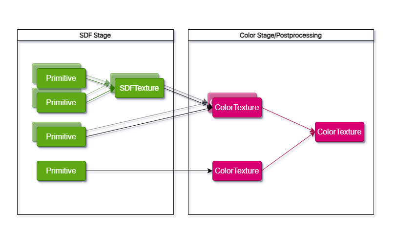

### What can i do with this engine?

Take a look below, or at the banner image, that was also created using this engine ;)
___

#### Primitives

<table>
    <tr>
        <th>Capsule</th>
        <th>Ring</th>
        <th>Diamond</th>
        <th>Polygon</th>
    </tr>
    <tr>
        <td></td>
        <td></td>
        <td></td>
        <td></td>
    </tr>
</table>

<table>
    <tr>
        <th>Arc</th>
        <th>Sector</th>
        <th>Ellipse</th>
    </tr>
    <tr>
        <td>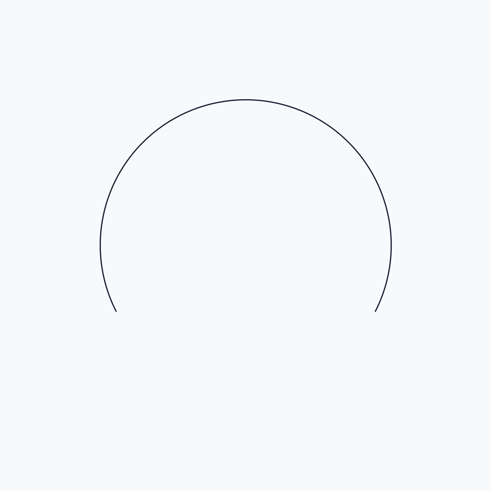</td>
        <td>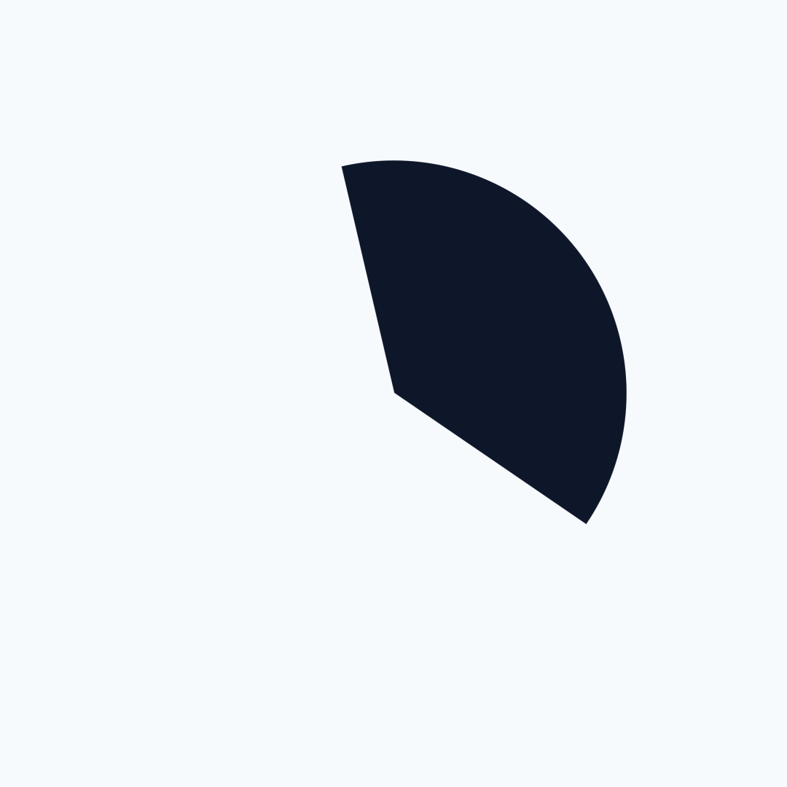</td>
        <td>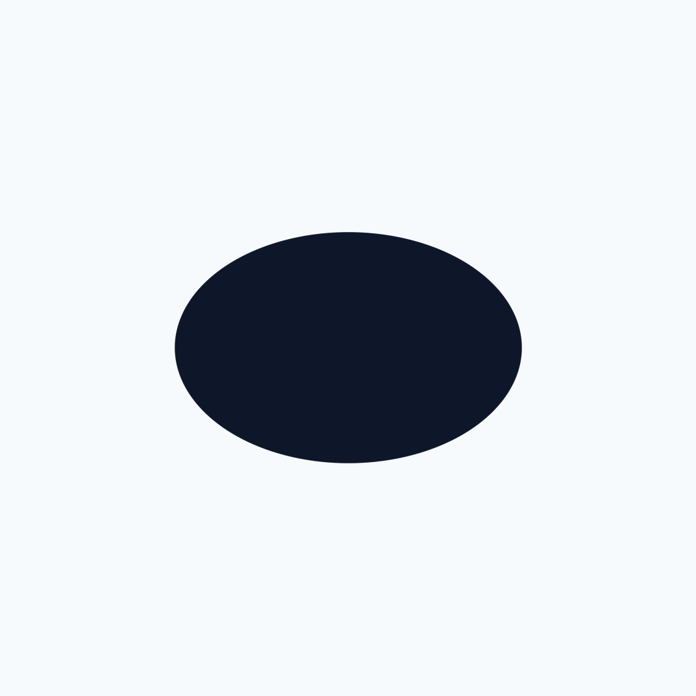</td>
    </tr>
</table>

#### Composition

<table>
    <tr>
        <th>Transparency</th>
        <th>Voronoi Field</th>
        <th>Cached Text</th>
        <th>Complex Shapes</th>
    </tr>
    <tr>
        <td>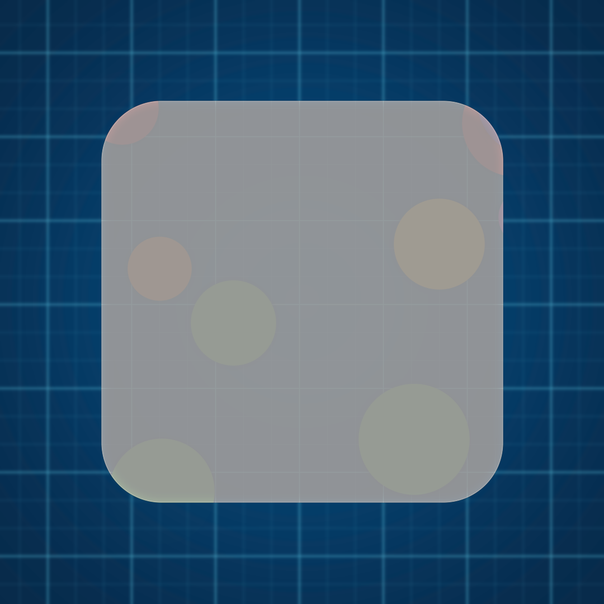</td>
        <td>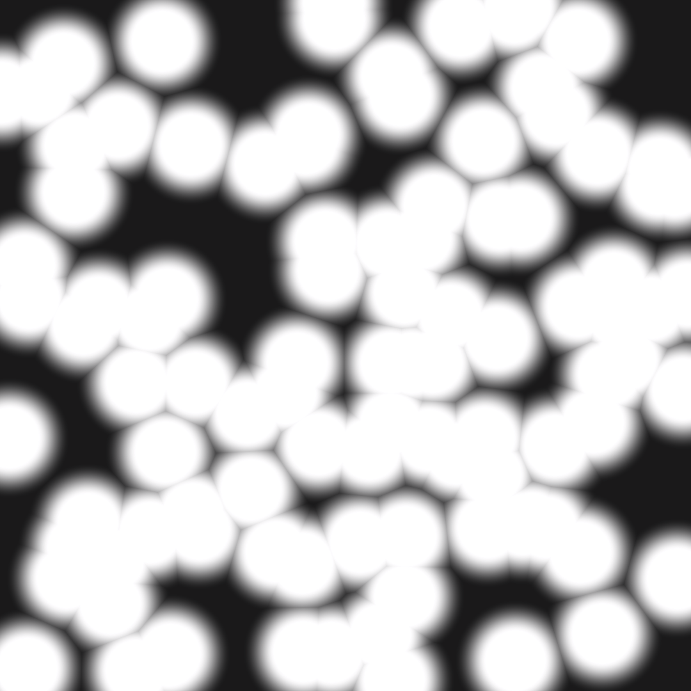</td>
        <td>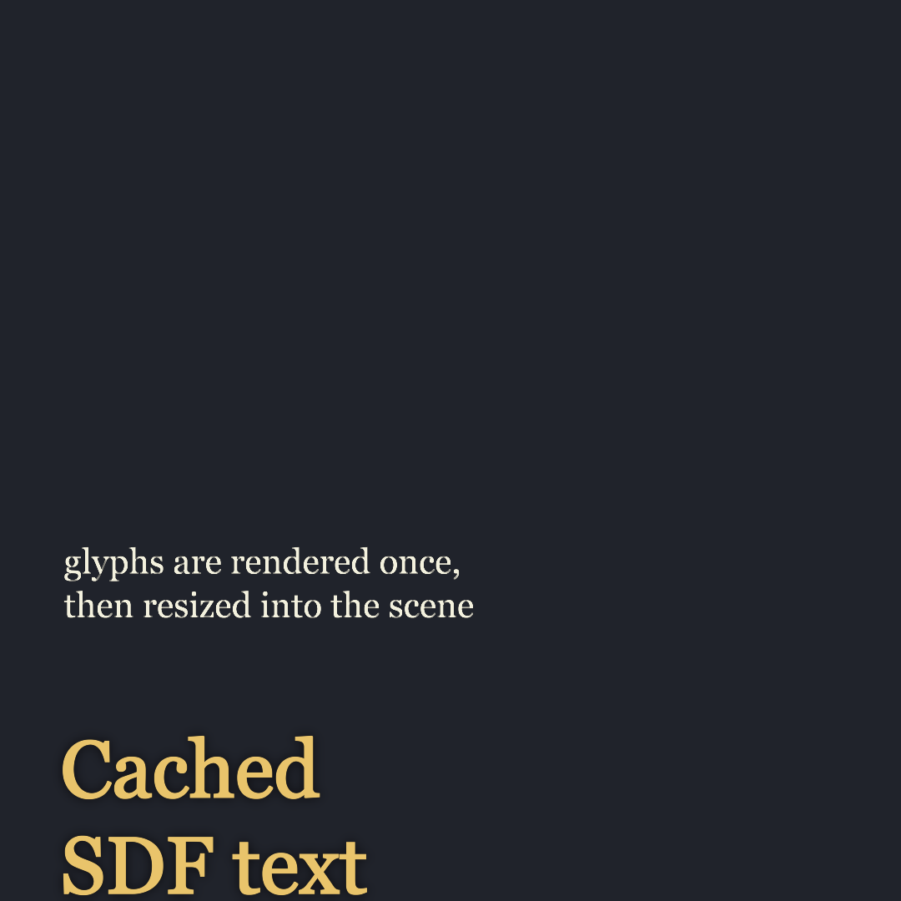</td>
        <td>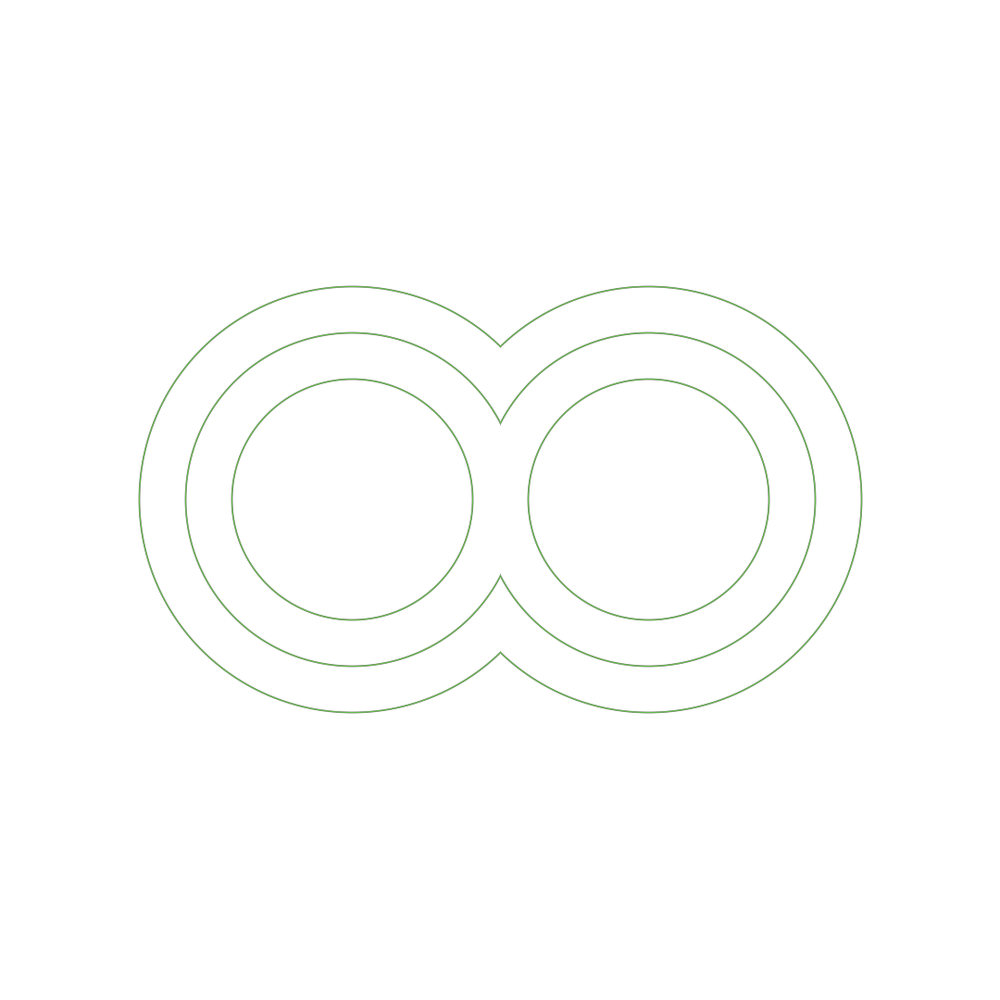</td>
    </tr>
</table>

<table>
    <tr>
        <th>Lighting</th>
        <th>Isolines</th>
        <th>Complex Shapes</th>
    </tr>
    <tr>
        <td></td>
        <td>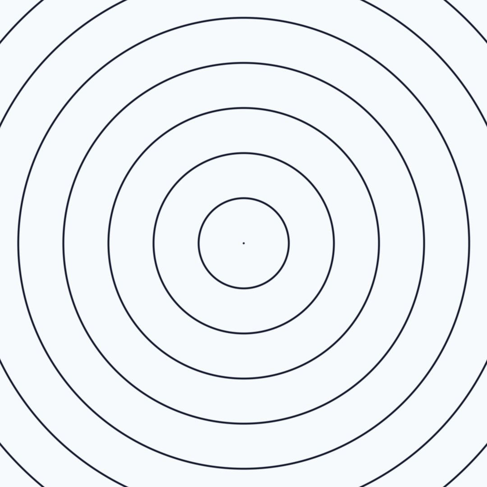</td>
        <td></td>
    </tr>
</table>

#### Larger Scenes

<table>
    <tr>
        <th>Impossible City</th>
    </tr>
    <tr>
        <td>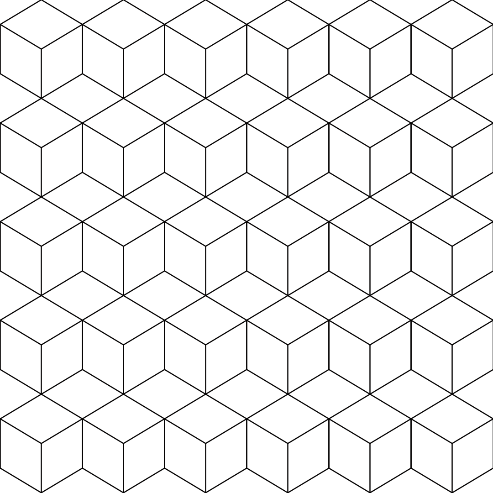</td>
    </tr>
</table>

### Performance Improvements


- [ ] Changing Local Size can (in theory) improve performance
- [ ] Dirty-region rendering so unchanged parts of the canvas can be skipped

- [ ] Voronoi bounding box based subframe rendering
- [ ] Subframe rendering (Smaller feature set but far better performance in most tasks)

- [ ] Render-graph caching for repeated subtrees and reusable procedural scenes

### Ideas for further development

- [x] Black and white to sdf conversion using go (solved via reverse sdf)
- [x] Fill with images (trough moderngl texture api)
- [x] Text rendering (Stroke rendering of single letters already possible)
- [x] Freeform Gradients (Overlay of Different gradients, possible trough half transparent fills of sdfs)

- [ ] Vector Fields
- [ ] Voronoi sdf (Basically many overlayed circle sdfs)
- [ ] Rendering of text with custom sdf font
- [ ] Ortographic Projection of 3D SDFs
- [ ] Domain warping and turbulence for procedural field-based scenes
- [ ] First-class glow, bevel, and inner-shadow effects
- [ ] Native animation timelines and time-based shader controls
- [ ] Native Support for animation
