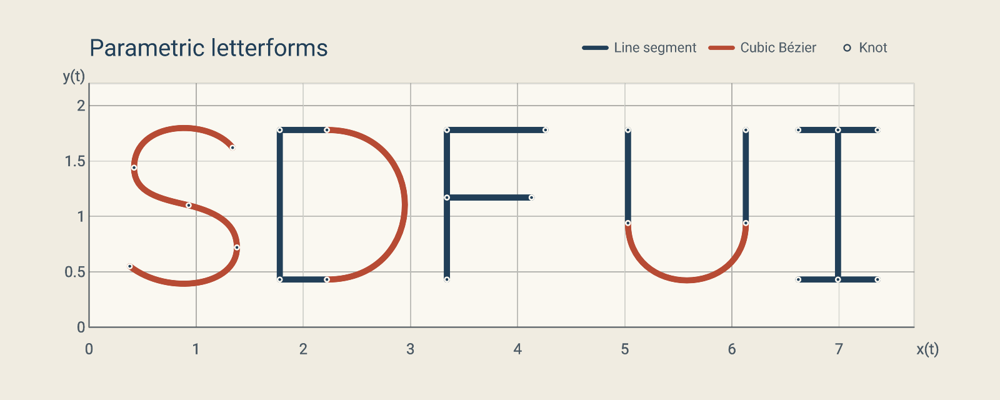
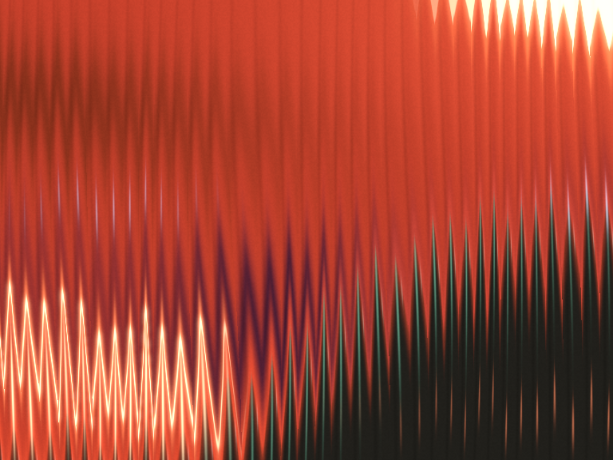
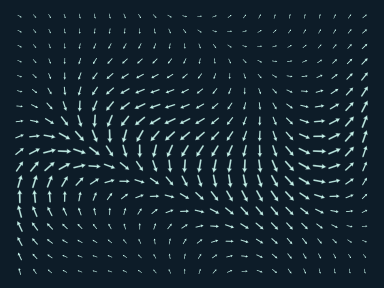
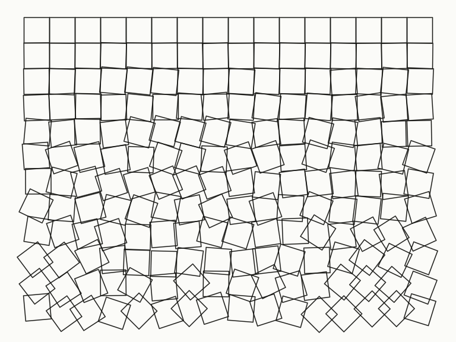
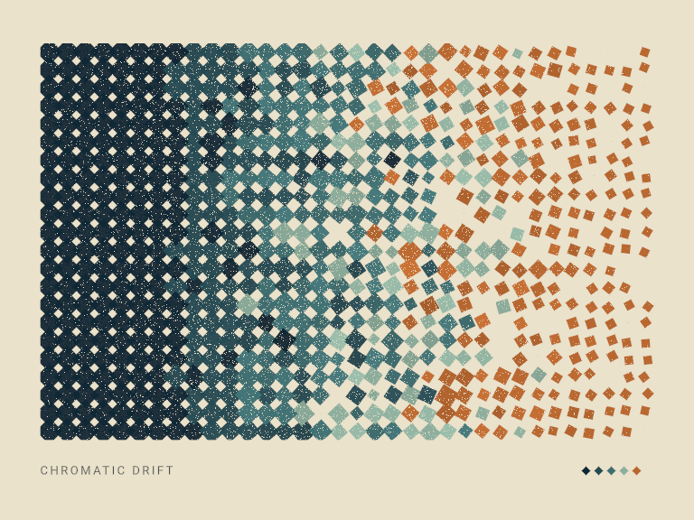
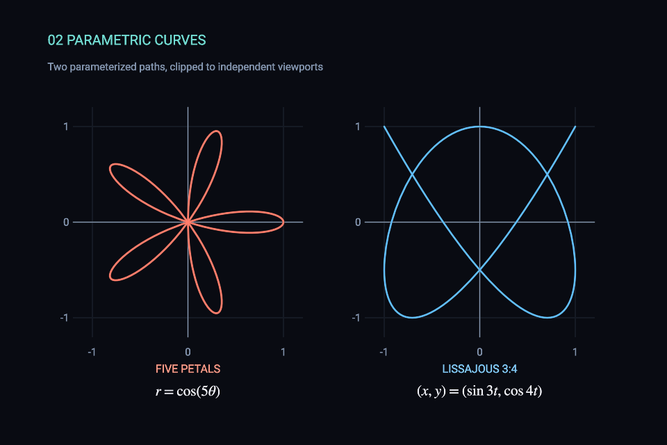
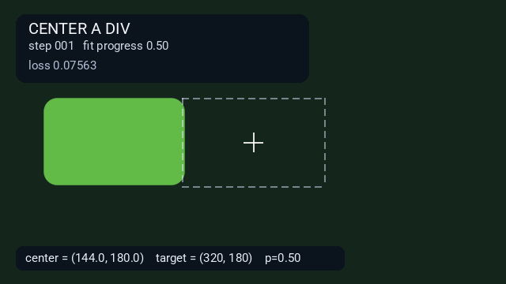

# SDF UI

SDF UI is a GPU-backed Python framework for high-fidelity generative art.
Build stills and animations from signed distance fields, procedural color,
vector fields, and composable effects. Use the same scene at preview or export
resolution, and drive geometry and shading with parameters that can be animated
or optimized.

The project grew out of a [metaballs experiment](https://github.com/sebastianjkern/metaballs).
Many of the distance functions are based on [Inigo Quilez’s SDF reference](https://iquilezles.org/articles/distfunctions2d/).

## Featured examples

<table>
  <tr>
    <th><a href="examples/molten_reflection.py">Molten Reflection</a></th>
    <th><a href="examples/texture_sampled_arrows.py">Texture Sampled Arrows</a></th>
  </tr>
  <tr>
    <td align="center"></td>
    <td align="center"></td>
  </tr>
  <tr>
    <td>Red light bends through fluted glass.</td>
    <td>Two texture maps set arrow angle and scale.</td>
  </tr>
  <tr>
    <th><a href="examples/spatial_parameters.py">Drifting Squares</a></th>
    <th><a href="examples/chromatic_drift.py">Chromatic Drift</a></th>
  </tr>
  <tr>
    <td align="center"></td>
    <td align="center"></td>
  </tr>
  <tr>
    <td>Sampled fields shift and rotate a grid of squares.</td>
    <td>A seeded print breaks from aligned diamonds into tilted squares.</td>
  </tr>
</table>

[Browse all examples and runnable code](examples/README.md).

## Quick start

SDF UI requires Python 3.11 or newer and a WebGPU adapter. Install the library
with pip:

```bash
pip install git+https://github.com/sebastianjkern/sdf_ui
```

To render an example, clone this repository and run these commands from its
root with [uv](https://docs.astral.sh/uv/getting-started/installation/):

```bash
uv sync
uv run python -m examples.molten_reflection
```

Repository examples write to `out/examples/<example>/` by default. This command
writes `out/examples/molten_reflection/molten_reflection.png`.

To draw your own image, create a shape, give it a color, and layer it over a
background. Save the scene with a canvas:

```python
from sdf_ui import Canvas, color, sdf

disc = sdf.circle((160, 120), 64).ink("#66e0c5")
scene = color.clear("#111c2b").over(disc)

with Canvas((320, 240)) as canvas:
    canvas.save(scene, "disc.png")
```

## Experimental features

### Plotting library

Use `sdf_ui.plot` to draw math figures and data charts on the same canvas as
your other artwork.

- Plot functions, parametric curves, and explicit points in data coordinates.
- Build charts from named columns with `Plot.from_data()`. Layer lines, points,
  bars, histograms, error bars, or uncertainty bands, and split groups into
  panels with shared scales.
- Compose the plot with other SDF layers and render it through the same canvas.

Plot a sine wave in data coordinates:

```python
from math import pi, sin
from sdf_ui import Canvas, color
from sdf_ui.plot import Plot

plot = Plot((60, 55, 520, 245), (-pi, pi), (-1.2, 1.2))
scene = color.clear("#111c2b").over(
    plot.axes(x_ticks=None, y_ticks=None),
    plot.curve(sin).stroke(3, "#66e0c5"),
)

with Canvas((640, 360)) as canvas:
    canvas.save(scene, "sine.png")
```

The math plot gallery draws a five-petal rose and a Lissajous curve in separate
viewports.



See the [math plot gallery](examples/plot_gallery.py) and the
[mark gallery](examples/mark_gallery.py).

### Learning API

Use `sdf_ui.learning` to fit scene parameters such as positions, sizes, and
colors to a layout goal, a reward, or a visual target.

- Define named parameters once and reuse the same scene as an optimizer updates
  their values. Use layout losses to improve alignment, spacing, and containment.
- Train a policy from a scalar reward to make layout decisions across viewport
  sizes, or fit shapes and colors against a target through a differentiable
  render graph.
- Render with the learned values and save checkpoints to resume training.
  Reference workflows run on the CPU, and supported render graphs can train
  on the GPU.

Fit a circle's radius by comparing its distance field with a target:

```python
from sdf_ui import Canvas, param, sdf
from sdf_ui.learning import Parameter

radius = Parameter("radius", 4.0)
circle = sdf.circle((16, 16), param("radius"))

with Canvas((32, 32)) as canvas:
    with canvas.capture(sdf.circle((16, 16), 9)) as target:
        target_pixels = target.read()

    def loss(graph):
        return ((graph["circle"].output - target_pixels) ** 2).mean()

    canvas.fit({"circle": circle}, loss, params={"radius": radius}, steps=80, lr=0.2)

print(f"Learned radius: {radius.item():.2f}")
```

The center-div example shows the optimizer moving a rounded panel toward
the center of the canvas over successive training steps.



See the [UI learning demos](examples/learning_ui.py) and the
[center-div source](examples/center_div.py).

## Development

See [Tasks.md](Tasks.md) for contributor setup, the development checklist,
and completed work. SDF UI is [MIT licensed](LICENSE).
