# SDF UI

What started [here](https://github.com/sebastianjkern/metaballs), has become a not yet fully featured but relatively complex 2d graphics rendering engine with gpu support.

SDF UI is the result of the experiment if you can extend the idea of MSDF text rendering and SDF based circle rendering to all standard 2D rendering stuff. Why don't draw rectangles, bezier curves, lines etc. with SDFs aswell. While in theory this is quiet slow, it offers great features like morphing between figures pretty much out of the box. And the determining factor of rendering cost is the size of the canvas and not the complexity of the object. For example the grid in the picture down below has pretty much the same cost as the rounded rectangle. And pretty much everything can be drawn with antialiasing without additional cost. And depending on what you're drawing, the rendered textures can be used again. 

Many SDFs used by this project were originally created by [Inigo Quilez](https://iquilezles.org/articles/distfunctions2d/).


### Why are basic Features not available?

All roads lead to Rome. Many basic sdf shapes can be expressed trough boolean operations of other basic shapes. For example convex polygons can be expressed as the intersection of halfplanes. Non-convex polygons are not as simple, but can be expressed trough this technique aswell. The trick is to render the union of convex polygons that make up the non-convex polygon.

The library also provides arc, half-plane, capsule, and polygon primitives directly.

### But why should i use the sdf-ui library?

While some functionality is not yet available or quiet expensive, many features are cost effective in comparison. While traditional render pipelines (atleast if they don't copy memory) have problems with repetition (Drawing 1000 circles is more expensive than 1 circle), sdf-ui can flex its muscles, because drawing equally spaced objects multiple times comes at a fixed cost. Drawing 1000 circles in a grid is not more expansive than drawing 100 circles in a grid.

This makes the renderer especially interesting for procedural 2D scenes, repeated motifs, boolean-heavy shape construction, and soft effects like antialiasing, outlines, masks, and morphing. Instead of paying mainly for scene complexity, many operations behave more like full-canvas field evaluation, which opens up a different set of strengths than a traditional draw-call-based backend.

### Installation:

The project requires Python 3.11 or newer and can be installed with pip:

```bash
pip install git+https://github.com/sebastianjkern/sdf_ui
```

The GPU renderer targets desktop Windows 10+, macOS 10.13+, and recent Linux
distributions with Vulkan support. Linux users may need Mesa or vendor Vulkan
drivers; WSL is not currently supported by `wgpu-py`.

For interactive work, prefer `Canvas.render(...)`, the built-in `.save(...)` method on render nodes, or a cached `Canvas.session(...)`.

Text and glyph rendering use the bundled Roboto font by default. The glyph SDF
cache renders at 2.5x the effective text size by default to leave a small quality
margin; increase ``oversample`` for unusually large resizes, at additional cache
cost. Text accepts TrueType or OpenType fonts, ordered fallback fonts, line
wrapping and clipping, and OpenType shaping controls:

```python
from sdf_ui import sdf

sdf.text("office AVATAR", features={"liga": False, "kern": True})
```

Filled SVG geometry can also be rendered directly as an SDF. This accepts
MathJax-style SVG with a `viewBox`, path definitions, local `<use>` references,
affine transforms, nonzero or even-odd fill rules, and one-line `<text>` nodes:
It evaluates SVG geometry at 2× subpixel resolution by default; use
`oversample=1` for faster rendering or increase it up to `4` for finer details.

```python
from pathlib import Path
from sdf_ui import sdf

math_svg = Path("formula.svg").read_text(encoding="utf-8")
formula = sdf.svg(math_svg, center=(320, 180), height=72)
scene = formula.fill("#f8fafc", "#00000000")
```

SDFs can be distorted by a superposition of vortices. Each vortex is an
`(x, y, strength)` tuple; positive and negative strengths rotate in opposite
directions. `color.vortex_streamlines(...)` draws the same field as an overlay:

```python
from sdf_ui import color, sdf

vortices = ((300, 360, 1.15), (660, 360, -1.15))
warped = sdf.circle((480, 360), 220).vortex_warp(
    vortices, radius=175, strength=0.9
)
flow = color.vortex_streamlines(vortices, radius=175)
scene = warped.fill("#d2ddd4").alpha_overlay(flow)
```

Run `uv run python -m examples vortices` to render the distorted contour and
streamline example. The warp is a CPU-backed resampling operation and returns
an ordinary SDF node that can be filled, contoured, cached, or composed.

Smooth booleans and spatial warps can change an SDF's gradient magnitude.
`normalize_distance()` applies the inexpensive local correction
`field / |gradient(field)|` near the zero contour and fades it out across a
finite band (32 canvas units by default). It improves nearby distance values
but is not a global reconstruction. `redistance()` instead rebuilds
approximate signed distances to the sampled zero contour, preserving the
contour while restoring more uniform offsets at canvas resolution. Both run on
the GPU; redistancing uses multiple jump-flooding passes and does not preserve
gradients for learning:

```python
from sdf_ui import sdf

soft_shape = sdf.circle((280, 180), 90).smooth_union(
    sdf.circle((390, 180), 90), k=24
)
locally_corrected = soft_shape.normalize_distance()
reconstructed = soft_shape.redistance()
```

Voronoi cells are available as signed fields. Select a site to get its
unbounded cell; compose cells or use `debug_distance()` to inspect their
distance values and boundaries:

```python
from sdf_ui import sdf

sites = [(160, 140), (420, 180), (280, 420)]
cell = sdf.voronoi(sites, cell=1)
debug = cell.debug_distance(range=80)
```

`debug_seams()` emphasizes regularly spaced contours, while
`debug_boolean(other, operation="union")` shows signed values and the result
boundary for union, intersection, or subtraction. The Voronoi operation returns
one selected cell at a time; cells are unbounded.
Its field is the maximum of the signed bisector distances, which is exact
inside the cell and a useful signed distance approximation outside it. The
distance heatmap reads the field back to the CPU for color mapping, so it is
intended for inspection rather than a performance-sensitive render path.

For TeX-like equations, `sdf.math(...)` uses Matplotlib's built-in MathText
parser and emits vector geometry for the same SVG renderer. It needs no Node.js,
npm, or system TeX installation. MathText supports a useful subset of TeX math;
install the optional dependency with `pip install 'sdf_ui[math]'`. It defaults
to the STIX font set, 0.75 canvas unit SDF inflation, and 2× subpixel
oversampling; set `inflate=0` or `oversample=1` to change those defaults:

```python
from sdf_ui import sdf

equation = sdf.math(
    r"\nabla \cdot \mathbf{u} = 0, \qquad"
    r"\frac{\partial \mathbf{u}}{\partial t}"
    r"+ (\mathbf{u} \cdot \nabla) \mathbf{u}"
    r"= -\nabla p + \nu \nabla^2 \mathbf{u}",
    center=(320, 180),
    height=120,
)
scene = equation.fill("#f8fafc", "#00000000")
```

The SVG renderer handles filled paths and simple one-line text; text uses the
matching system font when available, then the bundled Roboto fallback. Nested
`<tspan>` layout, strokes, gradients, filters, clipping paths, and external
references are not supported.

For denser output without changing scene coordinates, set a device scale on the
canvas. Geometry, text, and pixel-sized effects are scaled together; percentage
helpers continue to refer to the logical canvas dimensions:

```python
with Canvas((640, 360), device_scale=2) as canvas:
    scene.save("out@2x.png", ctx=canvas)
```

Use `direction`, `script`, and `language` to override inferred shaping runs, and
`variations={"wght": 650}` to set variable font axes. See
[`text_opentype`](examples/README.md) for a rendered example.

For fixed boxes, `align="justify"` expands word spacing on non-final lines.
`overflow="visible"`, `"clip"`, and `"error"` select box overflow behavior;
`trim_trailing_spaces=False` preserves the final space advance.


For development from a checkout, install [uv](https://docs.astral.sh/uv/getting-started/installation/) and run:

```bash
uv sync
uv run pytest
uv run python -m examples render_api
uv run python -m examples.learned_dashboard --steps 80
uv run python -m examples.center_div --steps 60
uv build
```

The lockfile keeps development and CI dependencies consistent. See
[the example index](examples/README.md) for more examples.

### Usage:

The public API is built around render nodes. `sdf` creates signed-distance-field textures,
`color` creates color textures, and `Canvas` materializes the same nodes on the GPU:

```python
from sdf_ui import Canvas, color, sdf

scene = (
    color.clear("#ffffff")
    .over(
        sdf.circle(("40%x", "50%y"), "18%min")
        .smooth_union(sdf.rect(("58%x", "50%y"), ("22%x", "18%y"), ("3%min", "3%min", "3%min", "3%min")), k="2%min")
        .fill("#62bb47", (0.0, 0.0, 0.0, 0.0))
    )
    .post.blur(1)
    .to_rgb()
)

cache = {}
with Canvas((640, 360)) as canvas:
    scene.save("out.png", ctx=canvas, cache=cache)
```

`render()` returns a materialized texture that owns a GPU image. Close it when
you are done, or use it as a context manager. Call `.read()` for a NumPy copy of
the rendered pixels:

```python
with Canvas((640, 360)) as canvas:
    with scene.render(canvas, cache=cache) as image:
        pixels = image.read()
        image.save("out.png")
```

Calling `scene.save(..., size=(640, 360))` creates and closes a temporary canvas
for one-off output. Pass `ctx=canvas` when you want to reuse a canvas across
multiple renders.

For repeated evaluations, `Canvas.session()` reuses one renderer and cache and
exposes render counters:

```python
with Canvas((640, 360)) as canvas:
    with canvas.session(cache={}) as renderer:
        image = renderer.render(scene)
        assert renderer.render(scene) is image
        with image:
            image.save("out.png")
        print(renderer.cache_info().hits)
        print(renderer.stats.shader_dispatches)
```

For a known region of interest, `evaluation_rect` limits shader evaluation and
returns a cropped image. Rectangles use `(x, y, width, height)` integer pixel
coordinates from the top-left of the canvas:

```python
with Canvas((640, 360)) as canvas:
    crop_scene = sdf.circle((300, 180), 90).fill("#62bb47").to_rgb()
    crop = crop_scene.render(canvas, evaluation_rect=(180, 80, 240, 200))
    print(crop.size, crop.origin)  # (240, 200), (180, 80)
```

The rectangle applies to every shader in that render. Pointwise operations are
supported; filters and shaders that sample neighboring pixels need a halo and
currently reject cropped evaluation. This explicit region is the first step
toward automatic bounds propagation.

### Architecture Note

Internally, `sdf_ui` is organized around immutable render nodes instead of immediate drawing calls.
Factories such as `sdf.circle(...)` and `color.clear(...)` do not render right away. They build a
small expression graph of `TextureNode` objects that can be composed, cached, and rendered later
against a `Canvas`.

At render time, the node graph is resolved by the renderer and dispatched through an internal
registry of built-in shader operations. Those operations are not a user extension API.

Tracked `.pyi` stubs provide editor completion and type checking. Dynamic core factory and
texture-operation signatures are generated from built-in operation metadata; GPU, graph, and
learning module stubs are maintained alongside their runtime APIs.

After changing built-in operation metadata, run `uv run python build_tools/generate_api_stubs.py`
and commit the generated core stubs. Run
`uv run python build_tools/generate_api_stubs.py --check` to check those stubs for drift
without modifying files. For development, install
[uv](https://docs.astral.sh/uv/getting-started/installation/), run `uv sync`,
then `uv run pre-commit install`; `uv run pre-commit run --all-files` checks tracked
files. If an older checkout configured `core.hooksPath` to `.githooks`, remove
that local setting with `git config --local --unset core.hooksPath` before
installing the hook.

Built-in primitives, shading passes, post effects, and composition operators are shader-backed
graph nodes implemented by the WebGPU backend. The public `Canvas` uses `wgpu-py` and targets
Windows, macOS, and Linux desktop systems.

### Learning layouts and graphics

`sdf_ui.learning` adds trainable parameters, reverse-mode autodiff, SGD/Adam,
semantic layout losses, and policies trained from reward callbacks. The CPU
reference backend requires no additional machine-learning dependency. A native
GPU render graph also supports combined image, field, and geometry objectives,
with GPU shader gradients and optimizer updates.

```python
from sdf_ui import Canvas, sdf
from sdf_ui import param
from sdf_ui.learning import Parameter
from math import pi, sin

offset = Parameter("offset", 0.0)
x = Parameter(
    "x",
    0.0,
    animate=lambda progress: 120 + 80 * sin(progress * 2 * pi) + offset,
)
scene = sdf.circle((param("x"), 32), 12)

def loss(graph):
    # x is evaluated at the selected frame; gradients flow to `offset`.
    return (graph.parameters["x"] - 120) ** 2

with Canvas((240, 64)) as canvas:
    canvas.fit({"shape": scene}, loss, params={"x": x, "offset": offset},
               progress=0.25, steps=50)
    scene.save("frame.png", ctx=canvas, params={"x": x}, progress=0.25)

print(offset.item())
```

An animated `Parameter` evaluates its callback at the normalized `progress`
for each render or training step. Its callback value is fixed for that frame
and is not itself trainable. Captured trainable parameters such as `offset`
remain differentiable. Inside a custom loss, `graph.parameters` exposes the
resolved values for the current frame. Set a frame per update with
`session.step(progress=...)` or `graph.run(..., progress=...)`; a fit call
uses one selected progress value for all of its steps.

The loss callback also receives differentiable layer outputs. It can combine
image or field losses with arbitrary scalar terms; targets are optional.
``graph[scene]`` can reference any layer in the compiled scene, including
intermediate layers. Accessing ``.output`` reads that layer back to a CPU Tensor
for Python loss evaluation. For built-in losses that keep image data on the
GPU, use ``canvas.training`` with an ``Objective``.

The CPU reference backend evaluates a documented subset of the existing render
operations as floating-point tensors. It has its own per-execution tape and
does not backpropagate through WebGPU or quantized display textures. Unsupported
operations raise an explicit error. Reward-based policy learning can use the
full GPU renderer because its reward callback does not need pixel gradients.

See [the learning guide](docs/learning.rst) for geometry optimization, continuous
and discrete policies, graph training, checkpoints, and runnable
examples.

The center div example uses an animated `Parameter` for its horizontal sweep
and trains a separate offset at progress `0.5`. It exports both the learning
curve at that frame and the final sweep:


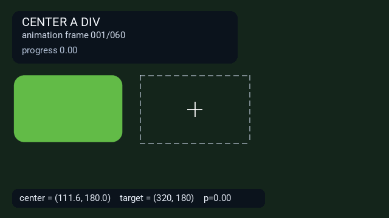

Run it with `uv run python -m examples.center_div --steps 60`; the script saves
both GIFs and individual PNG frames under `out/center_div/`. See
[the example source](examples/center_div.py).

For a larger procedural layout example, run
`uv run python -m examples.learned_dashboard --steps 80`. It learns how to distribute
space between three content cards across viewport and content scenarios, and
produces before/after/reference images plus held-out metrics. See the
[learning guide](docs/learning.rst#procedural-dashboard-example) for how to
load the checkpoint and evaluate new measurements.

All 43 registered shader passes also expose executable differentiation contracts
through `shader.differentiation` and `shader.backward(...)`. These analytic CPU
references report pixel-input gradients and reduced uniform gradients, including
multi-output passes and explicit zero-gradient cases. See the
[shader differentiation guide](docs/shader_differentiation.rst) for the API,
coverage and numerical conventions. The [native render graph guide](docs/gpu_render_graph.rst)
describes GPU execution, custom shaders, checkpoints, and limitations. Run its
combined field, image, and geometry optimization with
`uv run python -m examples.gpu_graph --steps 150`.

### How it works:

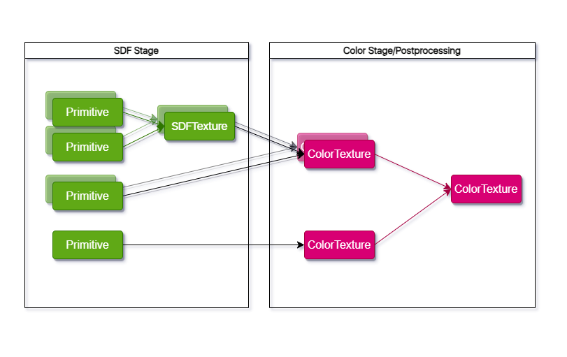

### What can i do with this engine?

Take a look below, or at the banner image, that was also created using this engine ;)
___

#### Primitives

<table>
    <tr>
        <th>Capsule</th>
        <th>Ring</th>
        <th>Diamond</th>
        <th>Polygon</th>
    </tr>
    <tr>
        <td></td>
        <td></td>
        <td></td>
        <td></td>
    </tr>
</table>

<table>
    <tr>
        <th>Arc</th>
        <th>Sector</th>
        <th>Ellipse</th>
    </tr>
    <tr>
        <td>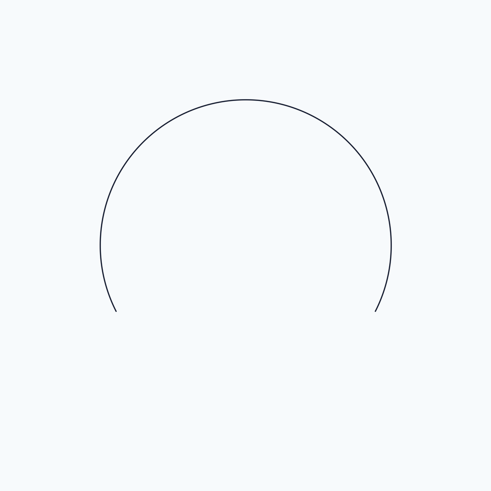</td>
        <td>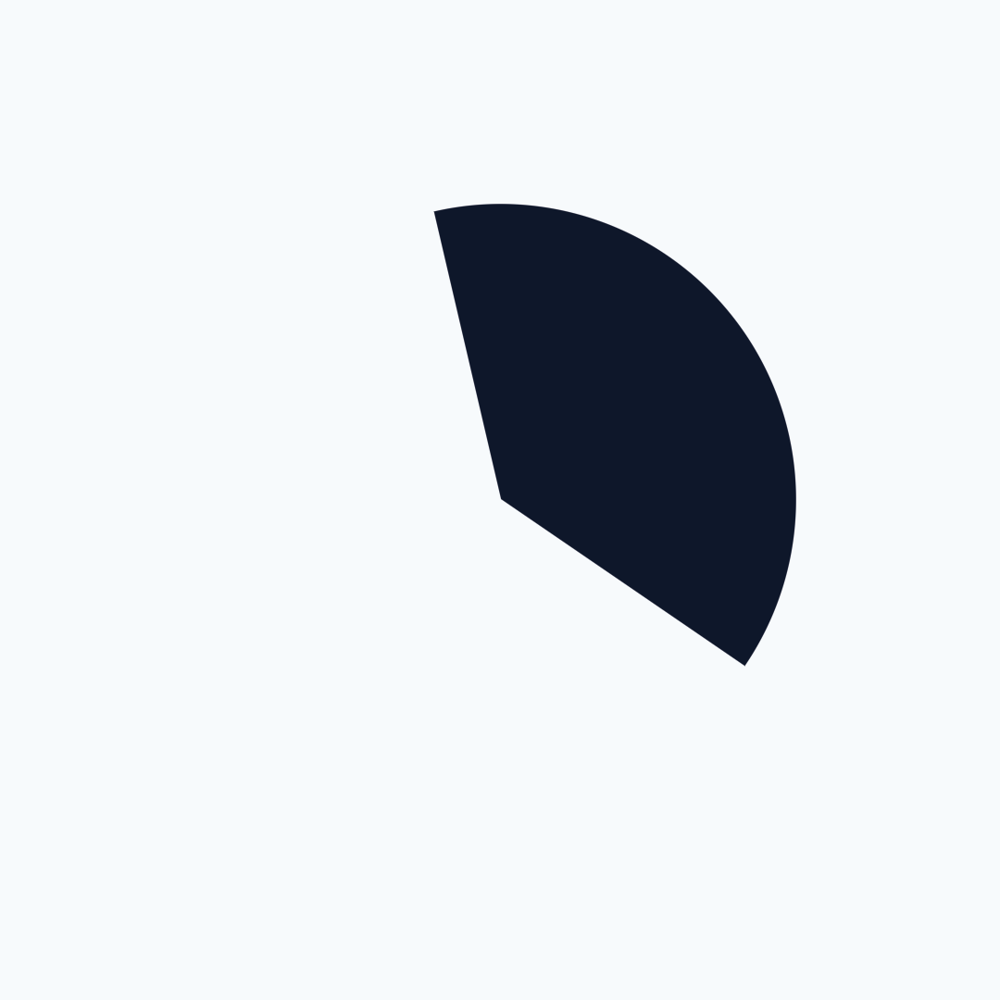</td>
        <td>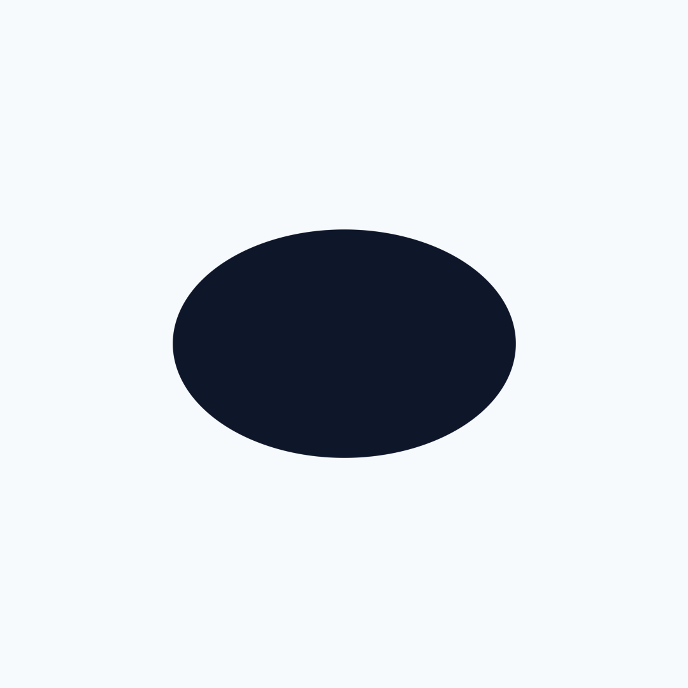</td>
    </tr>
</table>

#### Composition

<table>
    <tr>
        <th>Transparency</th>
        <th>Voronoi Field</th>
        <th>Cached Text</th>
        <th>Complex Shapes</th>
    </tr>
    <tr>
        <td>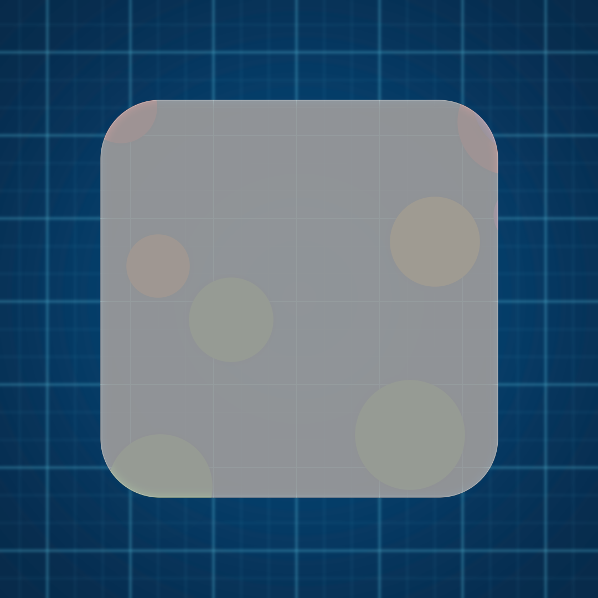</td>
        <td>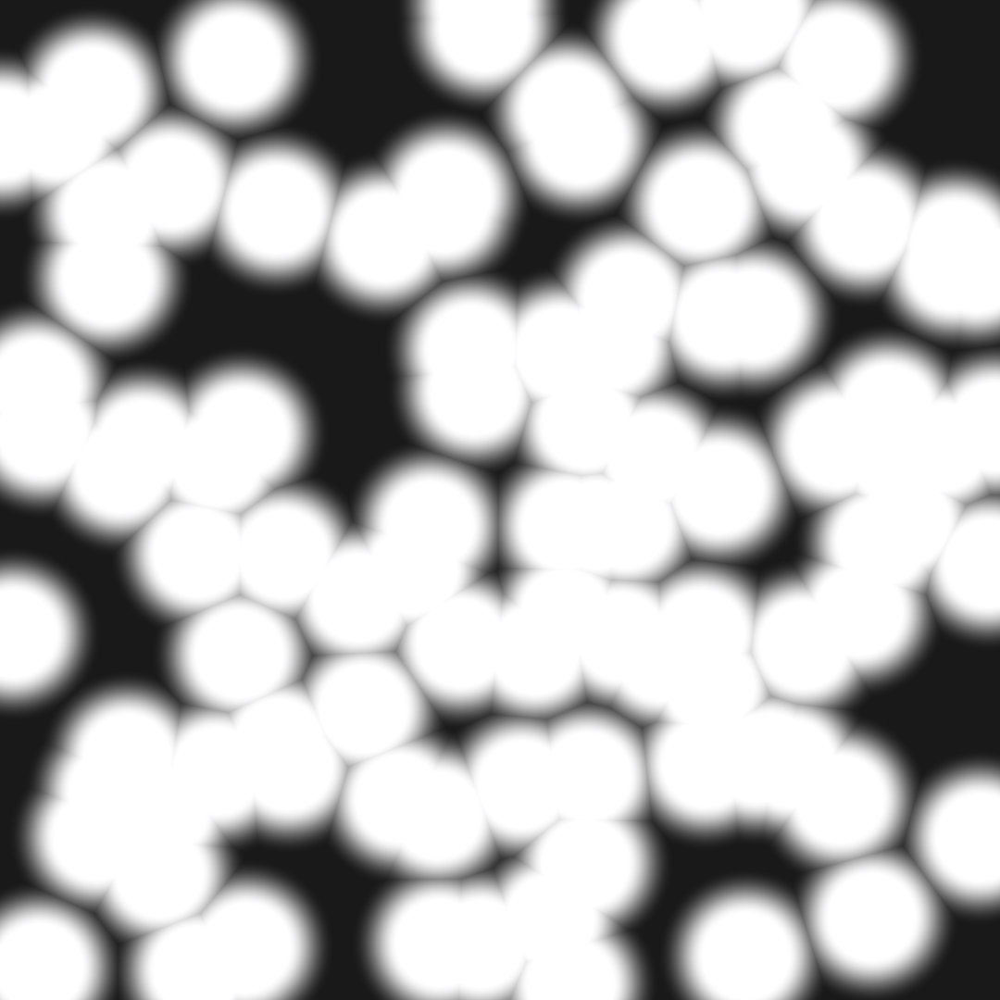</td>
        <td>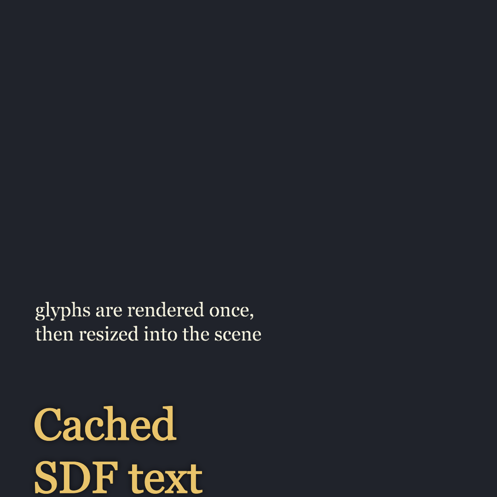</td>
        <td>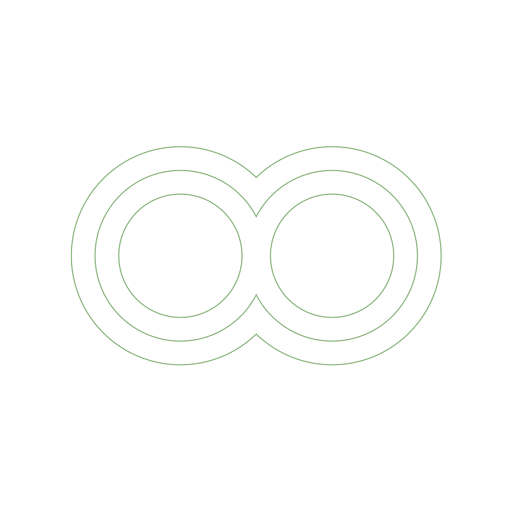</td>
    </tr>
</table>

<table>
    <tr>
        <th>Lighting</th>
        <th>Isolines</th>
        <th>Complex Shapes</th>
    </tr>
    <tr>
        <td></td>
        <td>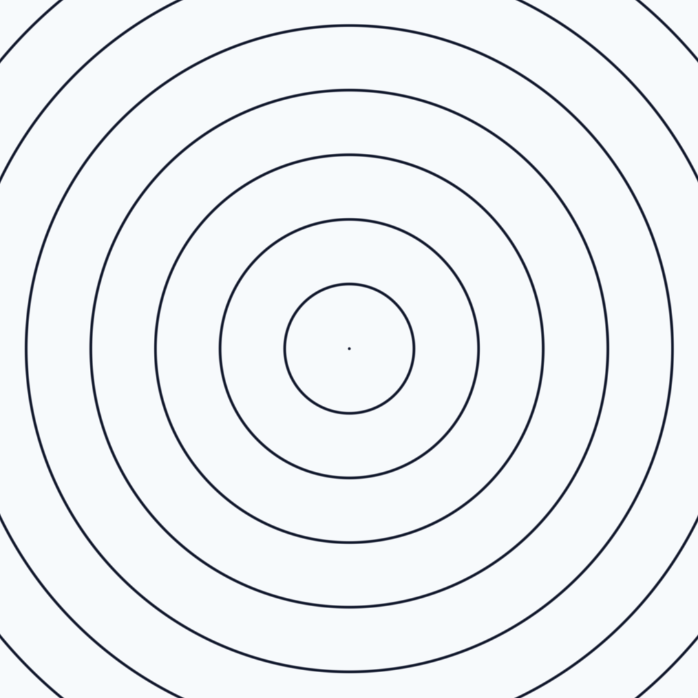</td>
        <td></td>
    </tr>
</table>

#### Larger Scenes

<table>
    <tr>
        <th>Impossible City</th>
    </tr>
    <tr>
        <td>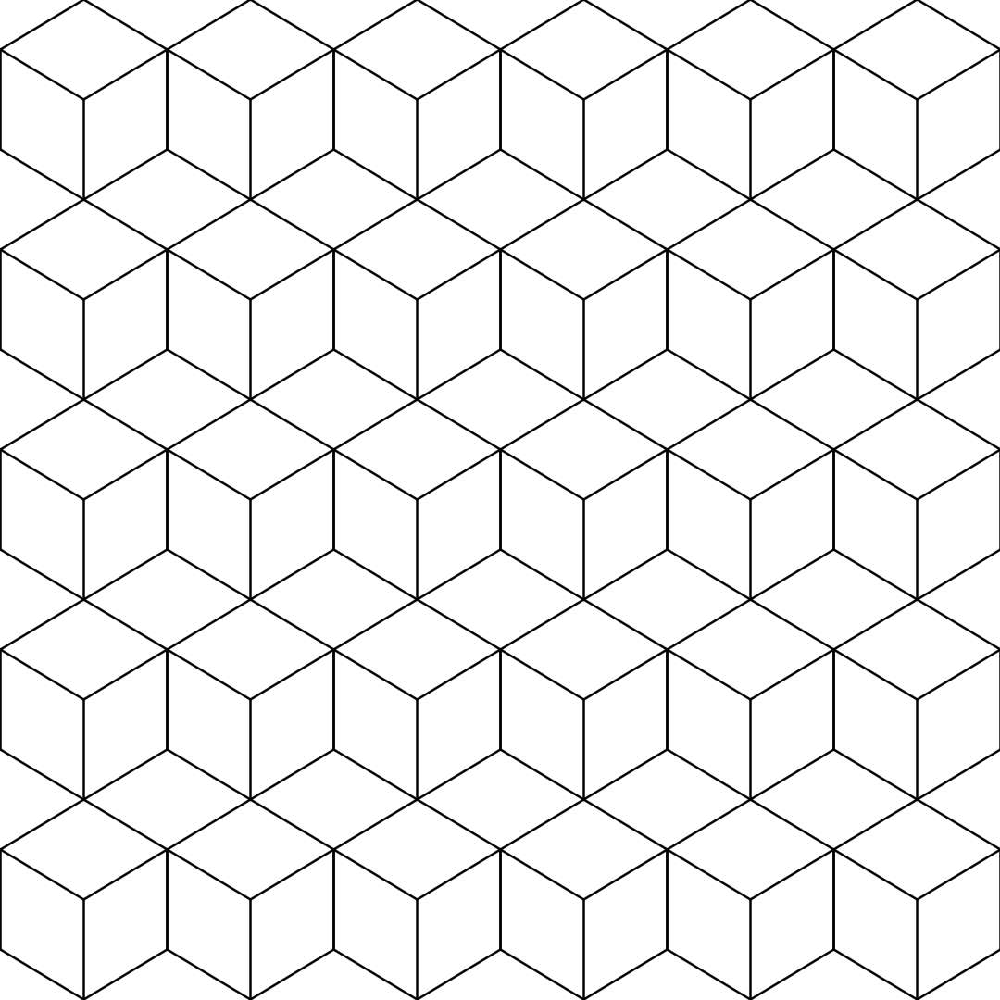</td>
    </tr>
</table>

### Development Checklist

The renderer already supports progress-driven animated parameters and GIF/MP4
export. This checklist tracks completed and remaining work by area.

#### Graph Architecture and Performance

- [ ] Establish clear shader and loss adapter boundaries around the rendering core.
- [ ] Finish organizing NumPy learning around graph nodes, including intermediate-value losses.
- [ ] Add incremental dirty-region rendering so unchanged canvas areas can be reused.
- [ ] Add bounds-aware shaders and clipping to skip work outside visible regions.
- [ ] Explore bounds-driven subframe rendering for procedural scenes such as Voronoi fields.

#### Procedural Fields

- [x] Add first-class Voronoi SDF support for selected cells.
- [ ] Add vector-field and flow-field primitives for distortion and motion.
- [x] Add vortex fields with SDF warping and streamline visualization.
- [ ] Add domain warping, turbulence, and contour-map operators.
- [x] Add field-debug views for distance values, seams, and boolean transitions.

#### Shape Composition

- [ ] Add variable-radius capsules.
- [ ] Add a stroke/combine pipeline for layered shape construction.
- [ ] Improve masked blending modes and masked-union antialiasing.
- [ ] Add per-path smoothing controls for joins and transitions.
- [ ] Convert layered masks into distance fields.

#### Text and Typography

`text([...])` accepts `span(...)` runs with per-run font paths, sizes, OpenType
settings, and decorations. Runs wrap, align, and clip in the same text box as
plain text. `measure_text(...)` reports line metrics and ink bounds, while
`measure_glyph(...)` measures a grapheme. `system_font(...)` resolves an
installed family when platform fonts are preferred; Roboto remains the stable
default.

- [x] Add OpenType shaping for script runs, ligatures, combining marks, and bidirectional text.
- [x] Add configurable text decorations, glyph and paragraph measurement, and first-line paragraph indentation.
- [x] Add optional system font resolution through `system_font()` and `path="system:Family Name"`.
- [x] Add inline rich-text spans with per-range font, size, and decoration styles.
- [ ] Add a shared glyph SDF cache or atlas to reduce repeated text-rendering work.
- [ ] Build a custom SDF font pipeline.

#### Animation and Motion

- [ ] Add native timelines and keyframe interpolation for positions, colors, transforms, and opacity.
- [ ] Add time-based shader uniforms and reusable easing functions.
- [ ] Add a public frame-sequence export API.

#### Shading, Effects, and Images

- [ ] Add screen, darken, lighten, soft-light, and richer multiply blend modes.
- [ ] Add explicit sRGB color management and color-space previews.
- [ ] Add noise variants beyond Perlin noise and film grain.
- [ ] Add standalone bevel, glow, inner-shadow, sharpen, and edge-detect effects, plus a reusable effect stack.
- [ ] Add XOR as a first-class layer or boolean operation.
- [ ] Improve image-to-SDF conversion beyond threshold-based tracing.
- [ ] Add image sampling, scaling, aspect-ratio, alpha, tint, and inflation controls.
- [ ] Improve texture loading for common formats and embedded color profiles.

#### 2.5D, Tooling, and Examples

- [ ] Add orthographic projection of 3D SDFs, height-to-normal shading, and depth-aware composition.
- [ ] Add a camera model and world-space transform stack.
- [ ] Add script hot reload for faster visual iteration.
- [ ] Add parameterized example presets and side-by-side comparisons.
- [ ] Add convenience helpers for icons, badges, and glyphs.
- [ ] Add palette-driven coloring helpers.
- [ ] Make texture resource cleanup easier to reason about and safer by default.
- [ ] Normalize naming across shader files, constants, and public methods.
- [ ] Add more generative-art showcase examples and a boid/swarm demo.
